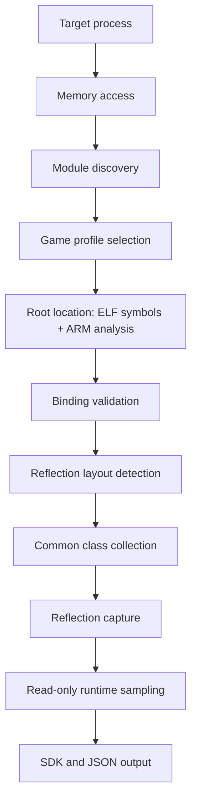

# NextDumper

**Runtime Unreal Engine SDK generation for Android.**

[](https://isocpp.org/)
[](https://cmake.org/)
[](https://developer.android.com/)
[](https://choosealicense.com/licenses/mit/)
[](https://github.com/Ezeny1337/NextDumper/releases/)

[中文文档](README_zh.md)

NextDumper attaches to a running Android game, locates Unreal Engine's object array and name pool, detects the reflection layout used by that build, and writes a C++ SDK with JSON metadata for analysis in IDA, Ghidra, or custom tools.

It does not depend on a fixed offset table for one engine build. Candidate roots and layouts are read from the live process and checked against the data before they are used. The generated files describe target memory; they are not a library you link into the game.

> **Match the target ABI.** Use the `arm64-v8a` build for 64-bit games and the `armeabi-v7a` build for 32-bit ARM games.

## Features

- **Engine globals** — locates and validates `GUObjectArray`, `ObjObjects`, and `FName` storage.
- **Reflection layout detection** — resolves `UObject`, `UStruct`, `FField`/`FProperty`, `UFunction`, and `UEnum` offsets for UE 4.23–5.6.
- **Full type dump** — outputs classes, structs, properties, functions, enums, inheritance, and field offsets.
- **Stripped binaries** — ARM64 and ARM32 (ARM mode) code analysis supplies extra root candidates when symbol lookup is not enough. Thumb/Thumb-2 is not supported yet.
- **IDA integration** — imports generated types and labels validated function entries with names and comments.
- **Common class addresses** — records `UClass` objects such as `World`, `Engine`, `GameInstance`, and `PlayerController`.
- **One output directory** — SDK headers, reflection data, runtime layout, a manifest, and diagnostics.
- **Rejects invalid data** — candidates and layouts that fail validation are not written to the output.
- **Limited reads** — object arrays, containers, and optional runtime samples all have explicit limits.

## How it works



1. Attach to the target process and find the Unreal module (`libUnreal.so` or `libUE4.so`).
2. Select a compiled game profile if one matches the package and module.
3. Collect object and name root candidates from ELF symbols, profiles, and code analysis.
4. Validate the object array and name pool against the expected layout.
5. Check the supported UE reflection layouts and select one that passes.
6. Collect common `UClass` objects.
7. Read reflected types, properties, functions, and enums.
8. Sample a limited set of runtime values in read-only mode.
9. Write the SDK and JSON files.

### Engine coverage

The reflection layout is detected at runtime, not selected by version number. The catalog contains these layout variants:

| Layout | Engine versions |
| --- | --- |
| `UProperty` | 4.23–4.24 |
| `FProperty` | 4.25–4.27 |
| `FProperty` with enum flags | 4.26–4.27 |
| `FField` explicit owner | 5.0 |
| `FField` explicit owner with enum package | 5.1–5.2 |
| `FField` tagged owner | 5.3–5.4 |
| Modern reflection | 5.5–5.6 |

`runtime.json` and `sdk/EngineLayouts.hpp` record the selected layout. `reflection.json` also records compatible profiles and the version confidence. Forks and custom builds can differ; the diagnosis report shows which stage failed instead of assuming a specific version. Reflection records are split into per-package shards; `reflection.json` lists them and holds only cross-cutting evidence.

## Getting started

### Requirements

- Android SDK with platform `android-29` (or a compatible platform).
- Android NDK r26 or newer. CI uses `26.3.11579264`.
- CMake `3.22.1` and Ninja.
- A host that can build Android `arm64-v8a` and `armeabi-v7a` binaries.
- Permission to read the target process memory and write to the output directory.

### Build script

`build.sh` configures the Android toolchain and enables ThinLTO by default.

| Mode | Configuration | Use |
| --- | --- | --- |
| `verify` (default) | Release, ThinLTO, no size optimization, assertions disabled | Quick compile check |
| `release` | Release, `-Oz`, ThinLTO, assertions enabled, stripped | Small distributable binary |
| `debug` | Debug symbols, ThinLTO, assertions disabled | Debuggable binary |

Set `ANDROID_NDK_HOME` (or `ANDROID_NDK_ROOT`) to NDK r26 or newer. If only `ANDROID_SDK_ROOT` is set, the script selects the newest installed NDK.

```bash
chmod +x build.sh

# Quick compile check (arm64-v8a by default).
./build.sh

# Size-optimized release build.
./build.sh --mode release --abi arm64-v8a

# Debug build for armeabi-v7a.
./build.sh --mode debug --abi armeabi-v7a --jobs 4
```

The binary is written to `build/android-<abi>-<mode>/NextDumper`. Use `--build-dir` to change the build directory, or `--no-strip` to keep symbols in the release build.

### CMake directly

This matches the configuration used by the GitHub Actions workflow:

```bash
cmake -S . -B build/android-arm64-release -G Ninja \
  -DCMAKE_TOOLCHAIN_FILE="$ANDROID_NDK_HOME/build/cmake/android.toolchain.cmake" \
  -DANDROID_ABI=arm64-v8a \
  -DANDROID_PLATFORM=android-29 \
  -DNEXTDUMPER_ENABLE_THINLTO=ON \
  -DCMAKE_BUILD_TYPE=Release

cmake --build build/android-arm64-release --parallel
```

The executable is written to `build/android-arm64-release/NextDumper`.

### Run

```text
NextDumper -o <output-dir> -p <package-name> [options]
```

Start the game first, then run NextDumper on the device. The tool needs permission to read the target process memory and write to the output directory; it does not bypass platform security restrictions.

| Option | Description |
| --- | --- |
| `-o`, `--output <dir>` | Writable directory for the log and generated files. Required. |
| `-p`, `--package <name>` | Package name of the target process. Required. |
| `--memory-log` | Also write `NextDumper_*.memory.jsonl` with memory read timings. Off by default. |
| `-h`, `--help` | Show command-line help. |

```bash
./NextDumper \
  --output /storage/emulated/0/NextDumper-output \
  --package com.example.game
```

## Output

A successful run creates a directory named after the package and the session timestamp:

```text
<output-dir>/com_example_game_20261021163000/
├── manifest.json           # artifact inventory and status
├── runtime.json            # module, binding, and resolved offsets
├── diagnostics.json        # reflection and generation diagnostics
├── reflection.json         # index: no type/function/enum records
├── reflection/             # one shard per UE package
│   ├── Engine.json
│   └── <Package>.json
└── sdk/                    # C++ declarations
    ├── SDK.hpp             # umbrella header, include this one
    ├── BasicTypes.hpp
    ├── EngineLayouts.hpp
    ├── Types.hpp
    ├── Enums.hpp
    └── Functions.hpp
```

The output directory also receives the session log and diagnosis report:

```text
<output-dir>/NextDumper_20261021163000.log
<output-dir>/NextDumper_20261021163000.diagnosis.json
```

| File | Contents |
| --- | --- |
| `sdk/SDK.hpp` | Umbrella header. Include this file to pull in the rest of the SDK. |
| `sdk/BasicTypes.hpp` | SDK primitives, fixed-size opaque storage wrappers, and container layout descriptions. |
| `sdk/EngineLayouts.hpp` | Runtime offsets for selected Unreal reflection structures. `-1` means the offset was not resolved for this target. |
| `sdk/Types.hpp` | Reflected Unreal classes and structs with names, inheritance, and field offsets. |
| `sdk/Enums.hpp` | Reflected enum declarations and values. |
| `sdk/Functions.hpp` | Reflected execution entry RVAs and parameter layouts. |
| `reflection.json` | Index for the reflection shards: status, profile, statistics, capture evidence, generation metadata, and limited runtime samples. It holds no type, function, or enum records. |
| `reflection/<Package>.json` | One shard per Unreal package, holding that package's types, functions, and enums with field storage descriptions. Shard names are listed in `reflection.json` under `shards`. |
| `manifest.json` | Output status, parsing statistics, and build information (commit, version, and worktree state). |
| `diagnostics.json` | Reflection and generation diagnostics, counters, and references to shared sample data. |
| `runtime.json` | Module information, binding layout, reflection offsets, and common class addresses. |

The headers use the `NextDumper` namespace and describe target memory. Reflected sizes, offsets, masks, and references are authoritative; the C++ declarations are descriptions of that layout, not native ABI-compatible definitions.

The timestamp is taken from local time when the session starts. If reflection or SDK generation is partial, the directory name contains `.partial`, for example `com_example_game.partial_20261021163000/`.

## Game profiles

Compiled profiles are the extension point for game-specific adaptations. Implement `IGameProfile` from `include/nextdumper/compat/GameProfile.hpp` and register the instance in `src/compat/GameProfiles.cpp`. Without a matching profile, the tool uses automatic discovery and default decoding.

```cpp
class ExampleGameProfile final : public nextdumper::compat::IGameProfile
{
public:
    std::string_view Id() const override { return "example-game"; }

    bool Matches(std::string_view packageName,
                 const nextdumper::module::ModuleImage &module) const override
    {
        return packageName == "com.example.game" && module.pointerWidth == 8;
    }

    nextdumper::binding::DecodePlan MakeDecodePlan(
        const nextdumper::memory::IMemorySource &,
        const nextdumper::module::ModuleImage &) const override
    {
        auto decode = nextdumper::binding::DecodePlan::Identity();
        // Only override decoders that were verified against the target build.
        return decode;
    }
};
```

Add the class to `CreateGameProfiles()`. If the implementation has its own `.cpp`, add that source to `CMakeLists.txt`.

| Hook | Purpose | Validation still required |
| --- | --- | --- |
| `Matches()` | Matches the package, ABI, and module | Must be unique; multiple matches cause the run to use default decoding. |
| `LocateRoots()` | Adds object or name root candidates | Candidates must pass the same layout and value checks. |
| `LayoutHints()` | Overrides the layout of one object or name container | Replaces automatic discovery for that container only; runtime checks still apply. |
| `MakeDecodePlan()` | Configures pointer, count, index, `FName`, header, and name-text decoders | Decoded values must still pass index, name, and layout checks. |

`Matches()` should check the package, target ABI, and module name where possible. Module identity is derived from mapped segments, not a content hash, so a package-name match does not prove that the target binary is identical to the sample you reverse engineered. Profile callbacks receive only the read-only `IMemorySource`; the decode plan is kept for the lifetime of the session, so do not capture short-lived objects.

## Compatibility diagnosis

Every run attempts to write `NextDumper_<timestamp>.diagnosis.json`, including runs that stop before binding or layout detection. The report contains the package, module, architecture, and pointer width, and separates the run result from the compatibility result:

- `session_status` — how far the dump ran.
- `compatibility_status` — the compatibility conclusion.
- `profile_status` — whether a profile was selected, activated, and validated.
- `findings[]` — entries with stable `domain`, `code`, `stage`, `confidence`, `summary`, and `next_action` fields.

| `compatibility_status` | Meaning |
| --- | --- |
| `not-evaluated` | The run stopped before compatibility could be checked. |
| `baseline-compatible` | Automatic discovery and default decoding completed. |
| `profile-selected` | A profile matched; no final conclusion yet. |
| `profile-validated` | The selected profile completed the full path. |
| `profile-validation-failed` | The selected profile failed a validation stage. |
| `needs-investigation` | The automatic path failed at binding, layout detection, or reflection. |
| `inconclusive` | Partial capture, ambiguous profile match, or an unstable address space. |

Findings follow these rules:

- Process, memory access, module, and output failures are reported as `runtime` findings.
- Without a profile, a failed root binding is reported as `ROOT_BINDING_NOT_VALIDATED`. This means root, layout, or decoding validation failed; it does not mean encryption was detected.
- A selected profile that fails validation is reported as `profile-validation-failed` with the failed stage and suggested inspection points.
- A complete automatic path is `baseline-compatible`; a complete profile path is `profile-validated`.
- A decoder exception is reported separately. During binding, the run retries with default decoding; in later stages it stops before writing results based on the failed decoder.

The report gives you concrete areas to inspect. It does not infer vendor algorithms or label an ordinary layout difference as encryption.

## IDA import

Run `tools/ida/nextdumper_import.py` from IDA and select a NextDumper output directory. The importer:

- writes `NextDumper_IDA_types.h` into the selected directory;
- imports the reflected byte-layout types into IDA's local type library;
- adds names and comments for validated execution entry RVAs and native function candidates whose RVA falls in an executable segment of the loaded image.

It does not apply runtime heap addresses to the static image and does not create functions automatically. Enum values outside the 32-bit C enum range stay in the reflection shard and are omitted from the generated IDA header. The importer also checks that the output's architecture and bitness match the IDA database.

The output contains no hash of the target binary. Confirm that the file open in IDA is the same image that was captured before relying on RVA annotations.

## Common class addresses

`runtime.json` can contain the following `UClass` objects:

```text
Engine
World
GameInstance
LocalPlayer
PlayerController
GameViewportClient
Console
CheatManager
```

These are class object addresses found in `GUObjectArray`. They are not the addresses of live instances such as the current `GWorld`, `GEngine`, or a player controller instance.

## Output status and exit codes

| Status | Meaning |
| --- | --- |
| `Complete` | Reflection capture and SDK output are complete; all required files were written. |
| `Partial` | Reflection capture or SDK output has omissions; the output directory name contains `.partial`. |
| `Failed` | Binding, layout detection, reflection, or file writing failed; output may be missing. |

| Exit code | Meaning |
| --- | --- |
| `0` | Complete output, or `--help`. |
| `1` | Runtime failure or an incomplete stage. |
| `2` | Invalid command-line arguments. |
| `3` | Partial reflection capture or SDK output. |

`manifest.json` records `reflection_status` and `sdk_status` separately. Fields emitted as fixed-size opaque storage keep their reflected size and semantics, but their contents are not expanded. Opaque storage alone does not make the SDK partial; omitted fields and layout warnings do.

JSON files keep complete field metadata. Logs keep diagnostic summaries, limited samples, and anomalies, with counts for omitted samples and references to the corresponding JSON records.

## Limitations

- The SDK is not a callable runtime library. Native C++ ABI compatibility is not guaranteed; use the reflected metadata instead of `sizeof` and `offsetof`.
- Execution entry RVAs do not necessarily point to the original C++ business logic.
- Runtime reads are not an atomic snapshot. `scan_complete` only covers object-slot enumeration, not every field or value.
- Optional runtime samples are limited and independently checked. Missing values do not reduce SDK completeness and do not imply native ABI compatibility.
- FText samples describe the outer storage, not arbitrary display strings.
- Sparse delegate inspection needs a located storage root and compatible layout candidates; some container element layouts and remote object resolution may remain unverified.
- Engine coverage does not guarantee compatibility with every fork or custom build. Use the diagnosis report to identify the failing stage.
- The output does not include a binary hash. Verify that the file used for IDA analysis matches the captured image.

## Reporting issues

Open an [issue](https://github.com/Ezeny1337/NextDumper/issues) for a reproducible detection, binding, layout, reflection, or output problem. Include:

1. The commit or release used.
2. Android version, device ABI, and target Unreal Engine version if known.
3. The command line, with package names or sensitive values redacted.
4. The relevant section of the timestamped `NextDumper_*.log`.
5. `manifest.json`, `diagnostics.json`, and `runtime.json` when available.
6. A short reproduction description and the expected result.

Remove credentials, private binaries, proprietary assets, and any information you are not authorized to share before uploading logs or output. Large reflection shards can be attached separately, or you can keep only the shard that holds the affected types.

## Disclaimer

NextDumper is provided for authorized research, debugging, interoperability, and development. You are responsible for obtaining permission to inspect the target process and for complying with applicable laws, licenses, platform rules, and software terms of service. Runtime layouts vary between engine versions, forks, build configurations, and shipping processes; successful binding does not guarantee that every generated field or function is complete or safe for production use. The project is provided without warranties, and the maintainers are not responsible for damage, data loss, service disruption, or misuse resulting from its use.

## License

NextDumper is licensed under the [MIT License](./LICENSE).