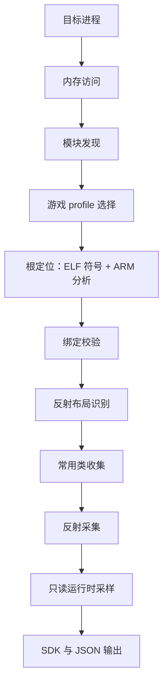

# NextDumper

**面向 Android 的 Unreal Engine 运行时 SDK 生成工具。**

[](https://isocpp.org/)
[](https://cmake.org/)
[](https://developer.android.com/)
[](https://choosealicense.com/licenses/mit/)
[](https://github.com/Ezeny1337/NextDumper/releases/)

[English](README.md)

NextDumper 会附加到正在运行的 Android 游戏进程，定位 Unreal Engine 的对象数组和名称池，识别该构建使用的反射布局，并生成 C++ SDK 与 JSON 元数据，供 IDA、Ghidra 或自研工具分析使用。

它不依赖某一套写死的偏移：所有候选根和布局都从目标进程实时读取，通过校验后才会使用。生成的文件描述的是目标内存布局，不能作为运行库链接进游戏。

> **ABI 必须与目标进程一致。** 64 位游戏使用 `arm64-v8a` 版本，32 位 ARM 游戏使用 `armeabi-v7a` 版本。

## 主要功能

- **定位引擎全局变量** —— 找到并验证 `GUObjectArray`、`ObjObjects` 和 `FName` 存储。
- **识别反射布局** —— 解析 UE 4.23–5.6 的 `UObject`、`UStruct`、`FField`/`FProperty`、`UFunction` 和 `UEnum` 偏移。
- **导出完整类型信息** —— 输出类、结构体、属性、函数、枚举、继承关系和字段偏移。
- **支持符号被剥离的游戏** —— 符号定位不充分时，通过 ARM64 和 ARM32（ARM 模式）反汇编补充根地址候选；暂不支持 Thumb/Thumb-2。
- **IDA 集成** —— 导入生成的类型，并为已验证的函数入口添加名称和注释。
- **常用类地址** —— 记录 `World`、`Engine`、`GameInstance`、`PlayerController` 等 `UClass` 对象地址。
- **输出集中** —— 头文件、反射数据、运行时布局、清单和诊断都在同一目录。
- **拒绝无效数据** —— 未通过校验的候选和布局不会写入输出。
- **控制读取量** —— 对象数组、容器和可选运行时采样都有明确上限。

## 工作原理



1. 附加到目标进程，找到 Unreal 模块（`libUnreal.so` 或 `libUE4.so`）。
2. 如果包名和模块匹配已编译的 profile，则选用该 profile。
3. 从 ELF 符号、profile 和代码分析中收集对象数组与名称池的根地址候选。
4. 按预期布局验证对象数组和名称池。
5. 检查支持的 UE 反射布局，选择通过校验的一种。
6. 收集常用 `UClass` 对象。
7. 读取反射出的类型、属性、函数和枚举。
8. 以只读方式采样少量运行时值。
9. 写入 SDK 和 JSON 文件。

### 引擎版本覆盖

反射布局在运行时检测，而不是按版本号直接选择。内置的布局版本如下：

| 布局 | 引擎版本 |
| --- | --- |
| `UProperty` | 4.23–4.24 |
| `FProperty` | 4.25–4.27 |
| 带枚举 flags 的 `FProperty` | 4.26–4.27 |
| `FField` 显式 owner | 5.0 |
| 带枚举 package 的 `FField` 显式 owner | 5.1–5.2 |
| `FField` tagged owner | 5.3–5.4 |
| 新版反射布局 | 5.5–5.6 |

`runtime.json` 和 `sdk/EngineLayouts.hpp` 会记录最终选择的布局，`reflection.json` 还会记录兼容的其他 profile 和版本可信度。不同分支或自定义构建可能存在差异；此时诊断报告会指出失败的阶段，而不是直接假定引擎版本。反射记录按包拆分为分片，`reflection.json` 只列出分片清单并保存跨包证据。

## 快速开始

### 环境要求

- Android SDK，包含 `android-29` 或兼容平台。
- Android NDK r26 或更高版本，CI 使用 `26.3.11579264`。
- CMake `3.22.1` 和 Ninja。
- 可构建 Android `arm64-v8a` 和 `armeabi-v7a` 的主机环境。
- 读取目标进程内存和写入输出目录的权限。

### 构建脚本

`build.sh` 会配置 Android 工具链，并默认启用 ThinLTO。

| 模式 | 配置 | 用途 |
| --- | --- | --- |
| `verify`（默认） | Release、ThinLTO、不优化体积、关闭断言 | 快速检查编译 |
| `release` | Release、`-Oz`、ThinLTO、启用断言、构建后 strip | 体积较小的发布版本 |
| `debug` | 调试符号、ThinLTO、关闭断言 | 便于调试 |

运行前将 `ANDROID_NDK_HOME`（或 `ANDROID_NDK_ROOT`）指向 NDK r26 或更高版本。如果只设置了 `ANDROID_SDK_ROOT`，脚本会自动选择已安装的最新 NDK。

```bash
chmod +x build.sh

# 快速检查编译，默认 arm64-v8a
./build.sh

# 体积优化的 release 版本
./build.sh --mode release --abi arm64-v8a

# armeabi-v7a 调试版本
./build.sh --mode debug --abi armeabi-v7a --jobs 4
```

可执行文件默认位于 `build/android-<abi>-<mode>/NextDumper`。使用 `--build-dir` 修改构建目录，或使用 `--no-strip` 保留 release 版本的符号。

### 直接使用 CMake

下面的配置与 GitHub Actions 工作流一致：

```bash
cmake -S . -B build/android-arm64-release -G Ninja \
  -DCMAKE_TOOLCHAIN_FILE="$ANDROID_NDK_HOME/build/cmake/android.toolchain.cmake" \
  -DANDROID_ABI=arm64-v8a \
  -DANDROID_PLATFORM=android-29 \
  -DNEXTDUMPER_ENABLE_THINLTO=ON \
  -DCMAKE_BUILD_TYPE=Release

cmake --build build/android-arm64-release --parallel
```

可执行文件位于 `build/android-arm64-release/NextDumper`。

### 运行

```text
NextDumper -o <输出目录> -p <包名> [options]
```

先启动游戏，再在设备上运行 NextDumper。工具需要读取目标进程内存和写入输出目录的权限，不会绕过平台安全限制。

| 参数 | 说明 |
| --- | --- |
| `-o`、`--output <dir>` | 保存日志和生成文件的可写目录。必填。 |
| `-p`、`--package <name>` | 目标进程的包名。必填。 |
| `--memory-log` | 额外写入 `NextDumper_*.memory.jsonl`，记录内存读取耗时。默认关闭。 |
| `-h`、`--help` | 显示命令行帮助。 |

```bash
./NextDumper \
  --output /storage/emulated/0/NextDumper-output \
  --package com.example.game
```

## 输出文件

一次成功运行会生成以包名和时间戳命名的目录：

```text
<输出目录>/com_example_game_20261021163000/
├── manifest.json           # 产物清单与状态
├── runtime.json            # 模块、绑定与已解析偏移
├── diagnostics.json        # 反射与生成诊断
├── reflection.json         # 索引，不含类型/函数/枚举记录
├── reflection/             # 每个 UE 包一个分片
│   ├── Engine.json
│   └── <Package>.json
└── sdk/                    # C++ 声明
    ├── SDK.hpp             # 聚合头，只需包含此文件
    ├── BasicTypes.hpp
    ├── EngineLayouts.hpp
    ├── Types.hpp
    ├── Enums.hpp
    └── Functions.hpp
```

输出目录下还会写入会话日志和诊断报告：

```text
<输出目录>/NextDumper_20261021163000.log
<输出目录>/NextDumper_20261021163000.diagnosis.json
```

| 文件 | 内容 |
| --- | --- |
| `sdk/SDK.hpp` | 聚合头文件；包含此文件即可引入其余 SDK 声明。 |
| `sdk/BasicTypes.hpp` | SDK 基础类型、定长不透明存储包装和容器布局描述。 |
| `sdk/EngineLayouts.hpp` | 所选 Unreal 反射结构的运行时偏移；`-1` 表示该偏移未解析。 |
| `sdk/Types.hpp` | 反射出的类和结构体，包含名称、继承关系和字段偏移。 |
| `sdk/Enums.hpp` | 反射出的枚举声明和值。 |
| `sdk/Functions.hpp` | 反射函数的执行入口 RVA 和参数布局。 |
| `reflection.json` | 反射分片的索引：状态、profile、统计、采集证据、生成信息和少量运行时采样；不包含类型、函数或枚举记录。 |
| `reflection/<Package>.json` | 每个 Unreal 包一个分片，包含该包的类型、函数、枚举及字段存储描述；分片文件名列在 `reflection.json` 的 `shards` 中。 |
| `manifest.json` | 输出状态、解析统计和构建信息（commit、版本、工作区状态）。 |
| `diagnostics.json` | 反射与生成诊断、计数，以及对共用采样数据的引用。 |
| `runtime.json` | 模块信息、绑定布局、反射偏移和常用类地址。 |

头文件使用 `NextDumper` 命名空间，描述的是目标内存。反射得到的大小、偏移、掩码和引用关系是判断依据；C++ 声明只是该布局的描述，不等同于 native ABI 定义。

时间戳在会话启动时按本地时间生成。反射或 SDK 生成不完整时，目录名会带 `.partial`，例如 `com_example_game.partial_20261021163000/`。

## 游戏 profile

游戏 profile 以编译期实现的形式提供，是适配特定游戏的扩展点。在 `include/nextdumper/compat/GameProfile.hpp` 中实现 `IGameProfile`，并在 `src/compat/GameProfiles.cpp` 中注册实例。没有匹配的 profile 时，工具使用自动发现和默认解码。

```cpp
class ExampleGameProfile final : public nextdumper::compat::IGameProfile
{
public:
    std::string_view Id() const override { return "example-game"; }

    bool Matches(std::string_view packageName,
                 const nextdumper::module::ModuleImage &module) const override
    {
        return packageName == "com.example.game" && module.pointerWidth == 8;
    }

    nextdumper::binding::DecodePlan MakeDecodePlan(
        const nextdumper::memory::IMemorySource &,
        const nextdumper::module::ModuleImage &) const override
    {
        auto decode = nextdumper::binding::DecodePlan::Identity();
        // 只覆盖已通过目标样本验证的字段解码器。
        return decode;
    }
};
```

将类加入 `CreateGameProfiles()`。如果实现需要独立的 `.cpp` 文件，请同时把它加入 `CMakeLists.txt`。

| 接口 | 作用 | 仍需通过的校验 |
| --- | --- | --- |
| `Matches()` | 匹配包名、ABI 和模块 | 必须唯一；多个匹配时会改用默认解码。 |
| `LocateRoots()` | 补充对象数组或名称池的根地址候选 | 候选仍需通过布局和取值校验。 |
| `LayoutHints()` | 覆盖对象数组或名称池的布局 | 只替代该容器的自动发现，运行时检查不变。 |
| `MakeDecodePlan()` | 配置指针、计数、索引、`FName`、header 和名称文本解码器 | 解码结果仍需通过索引、名称和布局校验。 |

`Matches()` 应尽量同时检查包名、目标 ABI 和模块名。模块标识来自已映射的段，不是内容哈希，因此包名匹配不能证明目标二进制与逆向样本完全相同。profile 回调只能通过只读的 `IMemorySource` 读取数据；解码配置会随本次会话一直保留，不要捕获短生命周期对象。

## 兼容性诊断

每次运行都会尝试写入 `NextDumper_<时间戳>.diagnosis.json`，即使流程在绑定或布局识别前就结束。报告包含包名、模块名、架构和指针宽度，并把运行结果与兼容性结论分开：

- `session_status` —— 运行进行到哪一步。
- `compatibility_status` —— 兼容性结论。
- `profile_status` —— profile 是否被选中、启用并通过验证。
- `findings[]` —— 每项包含稳定的 `domain`、`code`、`stage`、`confidence`、`summary` 和 `next_action` 字段。

| `compatibility_status` | 含义 |
| --- | --- |
| `not-evaluated` | 在检查兼容性之前已停止。 |
| `baseline-compatible` | 自动发现和默认解码完整走完。 |
| `profile-selected` | 已匹配 profile，但还没有最终结论。 |
| `profile-validated` | 所选 profile 完整走完全流程。 |
| `profile-validation-failed` | 所选 profile 未通过某个校验阶段。 |
| `needs-investigation` | 自动路径在绑定、布局识别或反射阶段失败。 |
| `inconclusive` | 采集不完整、profile 匹配有歧义，或地址空间不稳定。 |

诊断项遵循以下规则：

- 进程、内存访问、模块和输出失败记录为 `runtime` 问题。
- 没有 profile 时，根绑定失败记录为 `ROOT_BINDING_NOT_VALIDATED`。这只表示根、布局或解码未通过校验，不代表检测到加密。
- 已选 profile 未通过校验时记录为 `profile-validation-failed`，并给出失败阶段和排查建议。
- 自动路径完整通过时为 `baseline-compatible`；profile 路径完整通过时为 `profile-validated`。
- 解码器异常会单独记录。绑定阶段会改用默认解码重试；后续阶段则停止，不写入基于失败解码器的结果。

报告给出的是可复核的排查方向，不会推导厂商算法，也不会把普通的布局差异判定为加密。

## IDA 导入

在 IDA 中运行 `tools/ida/nextdumper_import.py`，选择 NextDumper 的输出目录。导入器会：

- 在所选目录中写入 `NextDumper_IDA_types.h`；
- 把反射出的字节布局类型导入 IDA 本地类型库；
- 为已验证的执行入口 RVA，以及 RVA 落在已加载镜像可执行段内的原生函数候选，添加名称和注释。

它不会把运行时堆地址写入静态镜像，也不会自动创建函数。超出 32 位 C 枚举范围的枚举值会保留在反射分片中，不写入生成的 IDA 头文件。导入器还会检查输出文件的架构和位数是否与当前 IDA 数据库一致。

输出中不包含目标二进制的内容哈希。使用 RVA 标注前，请确认 IDA 打开的文件与本次采集的镜像一致。

## 常用类地址

`runtime.json` 中可能包含以下 `UClass` 对象：

```text
Engine
World
GameInstance
LocalPlayer
PlayerController
GameViewportClient
Console
CheatManager
```

这些是从 `GUObjectArray` 中找到的类对象地址，不是当前运行实例的地址，例如当前的 `GWorld`、`GEngine` 或玩家控制器实例。

## 输出状态与退出码

| 状态 | 含义 |
| --- | --- |
| `Complete` | 反射采集和 SDK 输出完整，所有必需文件均已写入。 |
| `Partial` | 反射采集或 SDK 输出有遗漏，输出目录名包含 `.partial`。 |
| `Failed` | 绑定、布局识别、反射或文件写入失败，输出可能缺失。 |

| 退出码 | 含义 |
| --- | --- |
| `0` | 输出完整，或显示 `--help`。 |
| `1` | 运行时失败或阶段未完成。 |
| `2` | 命令行参数无效。 |
| `3` | 反射采集或 SDK 输出不完整。 |

`manifest.json` 分别记录 `reflection_status` 和 `sdk_status`。以固定大小不透明存储输出的字段会保留反射得到的大小和语义，但不会展开内部内容。不透明存储本身不会让 SDK 变成部分完成；遗漏字段和布局警告才会。

JSON 文件保留完整字段元数据。日志保留诊断摘要、有限的样本和异常，并记录省略的样本数量及对应 JSON 记录的位置。

## 已知限制

- SDK 不是可调用的运行库，不保证 native C++ ABI 兼容；请使用反射元数据，而不是 `sizeof` 和 `offsetof`。
- 执行入口 RVA 不一定对应原始 C++ 业务逻辑。
- 运行时读取不是原子快照。`scan_complete` 只表示对象槽位枚举完成，不代表所有字段和值都已采集。
- 可选的运行时采样有数量限制，并会独立校验。读不到值不会降低 SDK 完整性，也不代表具备 native ABI 兼容性。
- FText 采样描述的是外层存储，不是任意显示字符串。
- `SparseDelegates` 检查需要已定位的存储根和兼容的布局候选；部分容器元素布局和远程对象解析可能仍未验证。
- 引擎覆盖范围不保证适配所有分支或自定义构建，请用诊断报告定位失败阶段。
- 输出中没有二进制哈希；用于 IDA 分析的文件必须与采集时的镜像一致。

## 反馈问题

遇到可复现的目标识别、绑定、布局、反射或输出问题时，请提交 [Issue](https://github.com/Ezeny1337/NextDumper/issues)，并尽量附上：

1. 使用的 commit 或 release。
2. Android 版本、设备 ABI，以及已知的目标 Unreal Engine 版本。
3. 执行的命令；必要时请先隐藏包名或其他敏感值。
4. 相关的带时间戳 `NextDumper_*.log` 日志片段。
5. 可提供时附上 `manifest.json`、`diagnostics.json` 和 `runtime.json`。
6. 简短的问题复现步骤和预期结果。

上传日志或输出前，请移除凭据、私有二进制、专有资源以及任何未经授权不得分享的信息。较大的反射分片可以单独作为附件，也可以只保留包含问题类型的那个分片。

## 免责声明

NextDumper 仅面向获得授权的研究、调试、互操作和开发用途。使用者应自行确保拥有检查目标进程的合法授权，并遵守适用法律、许可证、平台规则和软件服务条款。不同引擎版本、分支、构建配置和 Shipping 进程之间的运行时布局可能存在差异；绑定成功不代表每个生成的字段或函数都完整，也不代表生成代码适合直接用于生产环境。本项目按现状提供，不作任何明示或默示保证；因使用、误用或无法使用本项目造成的损坏、数据丢失、服务中断或其他后果，维护者不承担责任。

## 许可证

NextDumper 基于 [MIT License](./LICENSE) 开源。